# AE Case Seriousness Console: Predicting Case Seriousness from FDA FAERS Data

A machine learning project that looks at a newly reported drug safety case and estimates whether it is likely to be **Serious** or **Non-Serious**, so that safety teams can review the most important cases first.

**Live app:** https://faers-drug-safety-prediction-8u4x3h3hc3qgobmz4bgbzs.streamlit.app/

---

## At a glance

| | |
|---|---|
| Data | FDA FAERS public data, 2025 Q1–Q4 (training and testing) and 2026 Q1 (unseen future check) |
| Size | 1,469,305 unique cases (one row per case) |
| Question answered | Is this case likely to be Serious or Non-Serious? |
| Final model | XGBoost, 82 features, decision threshold 0.4 |
| Accuracy | 78.8% on 2025 test data, 75.7% on unseen 2026 data |
| ROC-AUC | 0.872 on 2025 test data, 0.860 on unseen 2026 data |
| Tools | Python, pandas, scikit-learn, XGBoost, LightGBM, SHAP, Streamlit |

---

## 1. Background

In drug safety (pharmacovigilance), every adverse event report about a patient is called a **case**. Each case must be judged as **Serious** (for example death, hospitalization, life-threatening, disability, birth defect, or another important medical event) or **Non-Serious**. Serious cases must be reported to regulators much faster, so deciding this correctly and early matters.

Today this decision is made by people following rules. It depends on complete case information, which is often not available the moment a case arrives. That can delay the flagging of serious cases.

## 2. Objective

Build a model that uses the details available early, such as the patient, the drug, who reported the case, and how many reactions and concomitant medications (other medicines the patient was taking) were reported, to estimate whether a new case is likely to be Serious.

The model is a **triage helper**. It helps teams decide which cases to look at first. It does **not** replace the formal seriousness decision made by a trained safety professional.

## 3. Where the model fits in the case-handling process

Every case goes through these steps:

1. Case intake (the report is received)
2. Validity check (identifiable reporter, patient, suspect drug and event)
3. **Case triage** (the model applies here)
4. Data entry and coding
5. Medical review (including expectedness and causality)
6. Regulatory reportability decision
7. Submission to the health authority

The model supports **case triage**, which comes right after the validity check and before full data entry. It gives an early Serious / Non-Serious estimate from the details visible in the incoming report (patient, suspect drug, reporter, and the number of reactions and concomitant medications), so likely-serious cases can be prioritized sooner. It does **not** replace the formal seriousness assessment made by a trained safety professional.

At triage the case has not yet been submitted, so "how long it took to reach the FDA" is not known. This is why the reporting-delay feature was removed (see Step 11).

## 4. Scope

- Uses public FDA FAERS data only.
- Predicts seriousness only. It does not say whether a drug caused the event.
- Trained on 2025 data and checked on 2026 data that the model had never seen.

## 5. The data

FAERS is the FDA's public database of adverse event reports. Each quarter comes as seven separate tables, which together describe each case:

| Table | What it holds |
|---|---|
| DEMO | Patient details (age, sex), reporter type, report dates |
| DRUG | Drugs involved (suspect, secondary, concomitant) |
| REAC | Reactions reported |
| OUTC | Outcomes (death, hospitalization, etc.) |
| THER | Therapy start and end dates |
| INDI | Reasons the drug was being used |
| RPSR | Report source |

## 6. What was done, step by step

**Step 1: Load the data.** All four quarters of 2025 were loaded and combined. There were 1,617,444 rows in total.

A sample of each of the seven tables, as loaded (DEMO, DRUG, REAC, OUTC, THER, INDI, RPSR):

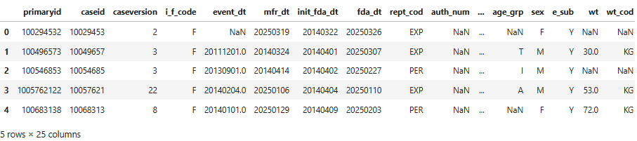

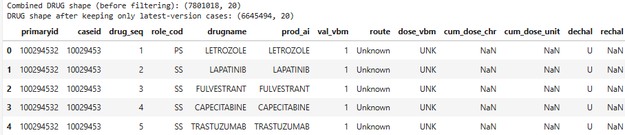

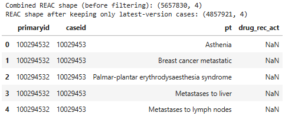

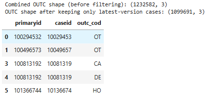

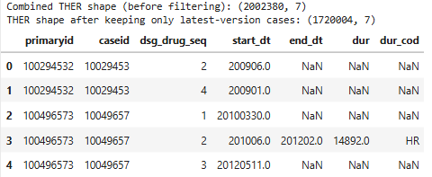

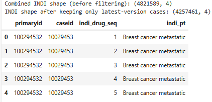

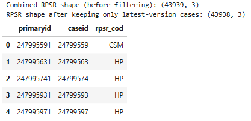

**Step 2: Remove duplicates.** A case can be reported more than once as new information arrives. Only the latest version of each case was kept, which removed 148,139 duplicate rows and left 1,469,305 unique cases.

**Step 3: Combine the seven tables into one row per case.** Some tables have many rows per case (for example, one case can have many reactions). These were summarized so that each case became a single row.

**Step 4: Define what we want to predict.** A case is labelled **Serious** if it has at least one outcome recorded in the outcomes table, otherwise **Non-Serious**.

| Label | Cases | Share |
|---|---|---|
| Serious | 823,213 | 56.0% |
| Non-Serious | 646,092 | 44.0% |

**Step 5: Clean the data.** Columns with more than 80% missing values were dropped. Impossible ages were removed. Missing categories were marked as "Unknown". Dates that did not make sense (for example a report dated before the event) were checked and handled.

Data types and missing values in the combined data:

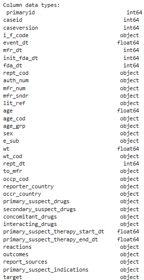

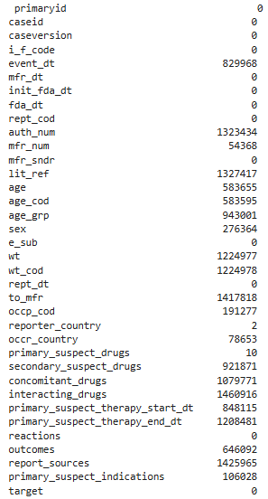

Some ages were recorded with the wrong unit (for example "DEC" meaning decades was mislabelled), which gave impossible ages. These were corrected:

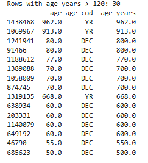

The event date was missing for 56% of cases. We checked whether the missing dates followed a pattern (by report type and by initial vs follow-up report), and added a flag "event date reported: yes/no" instead of guessing the dates:

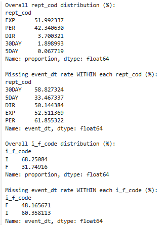

Value counts for sex, reporter occupation and country:

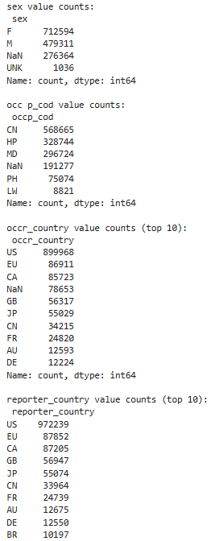

**Step 6: Create useful new information (feature engineering).** From the raw data we built simpler measures, such as how long the patient was on the drug, how many reactions were reported, how many secondary suspect drugs and concomitant medications were listed, and whether the event date was given. Only the *counts* of reactions, indications, secondary suspect drugs and concomitant medications were used, not the specific terms.

Therapy duration and reporting delay summaries (some negative values were impossible and were treated as missing):

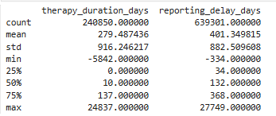

Most count columns are heavily skewed (a few cases have hundreds of drugs or reactions). Before and after applying a log transformation, which squeezes the extreme values so the model is not dominated by them:

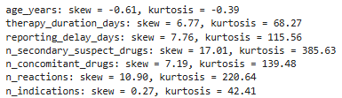

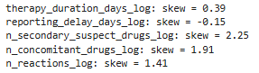

**Step 7: Explore the data.** Charts and statistics showed clear patterns. For example, cases reported by physicians were serious 75% of the time compared with 41% for cases reported by consumers. Elderly patients and follow-up reports also leaned towards Serious. No single number was strongly predictive on its own, so the model needs to combine many signals.


**Looking at each number on its own (histogram and boxplot):**

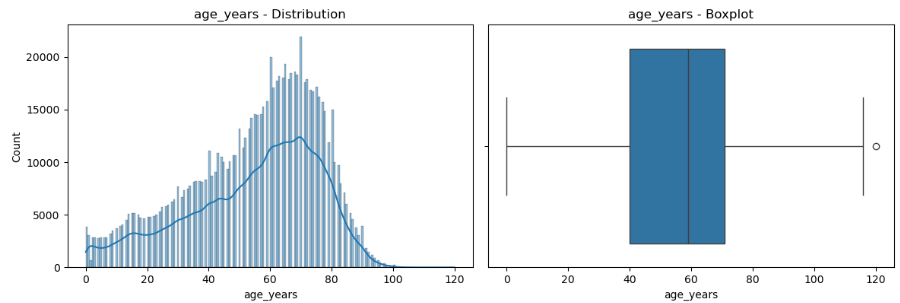
Age is roughly bell-shaped, with a peak around 60-70 years.

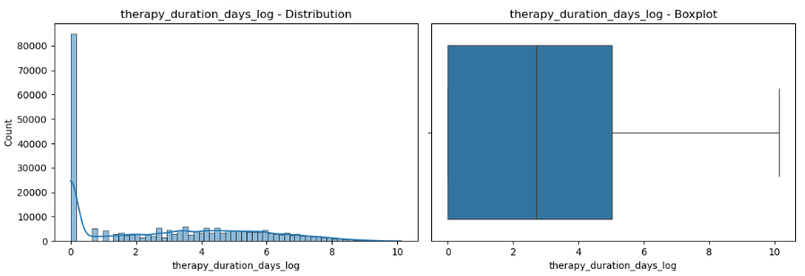
Many cases report a therapy duration of zero (a spike at 0), the rest are spread out.

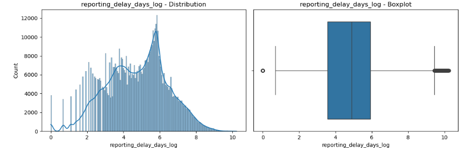
Reporting delay has several peaks, matching the reporting cycles.

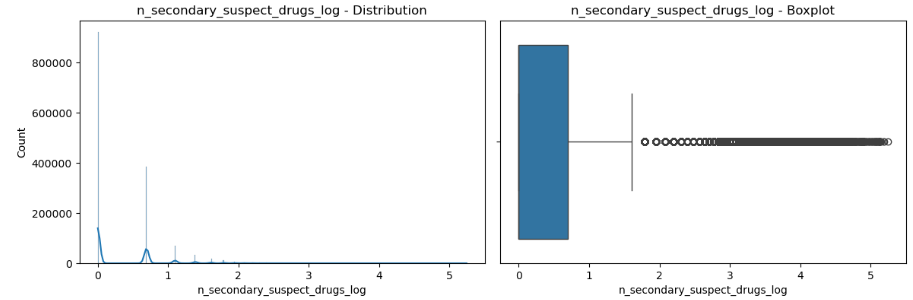

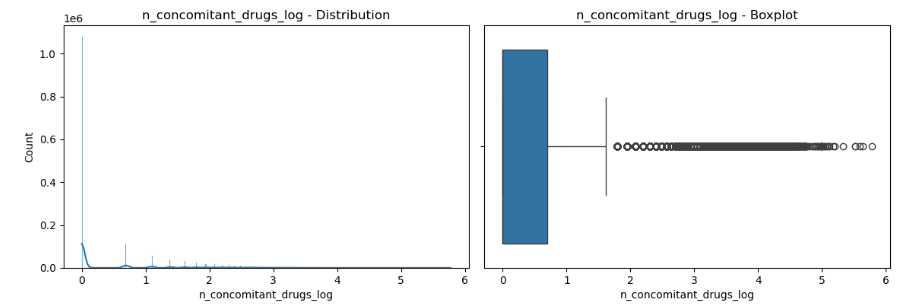

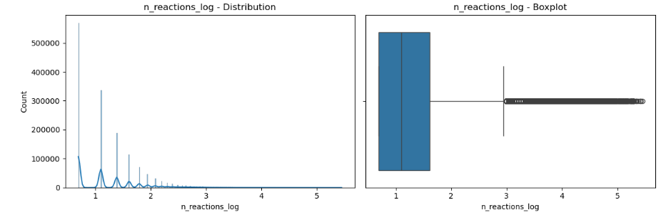

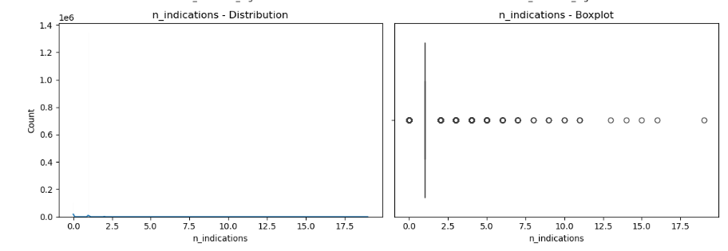

Most cases have very few secondary suspect drugs, concomitant medications and reactions, while a small number have very large counts.

**Do these numbers differ between Serious and Non-Serious cases? (raw values)**

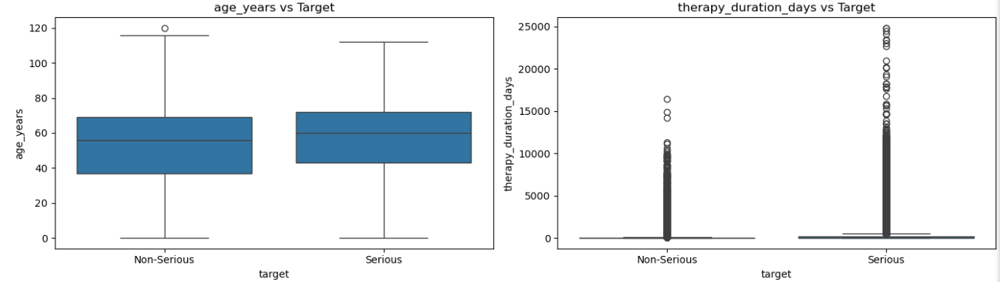

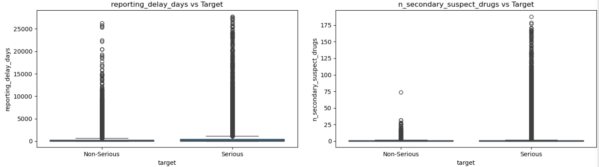

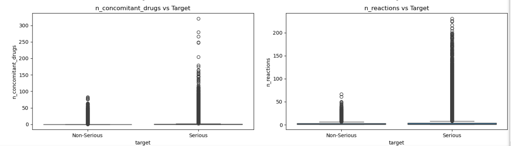

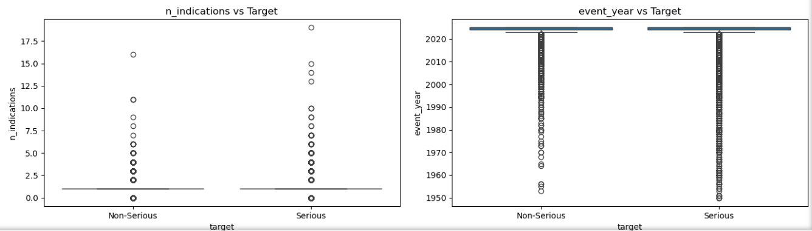

Serious cases have much longer tails: more reactions, more secondary suspect drugs, more concomitant medications and longer therapy. Number of indications and event year show weak or no signal.

**Same comparison after the log transformation:**

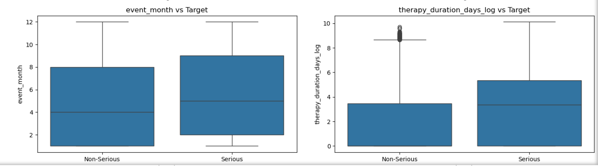

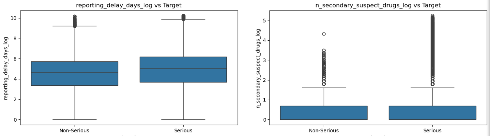

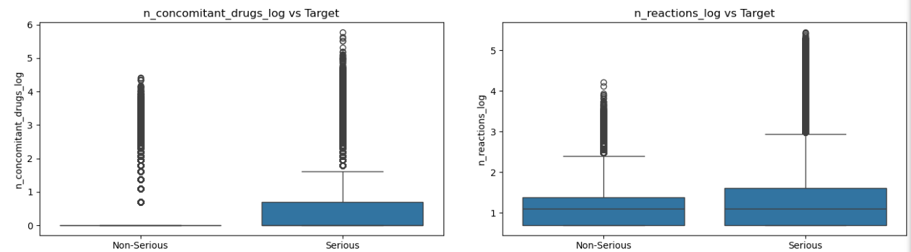

After the log transformation, longer therapy and more concomitant medications still stand out for Serious cases. The reaction count looks similar between groups once extreme values are squeezed, so the earlier signal came mostly from a small number of very large cases.

**Categories:**

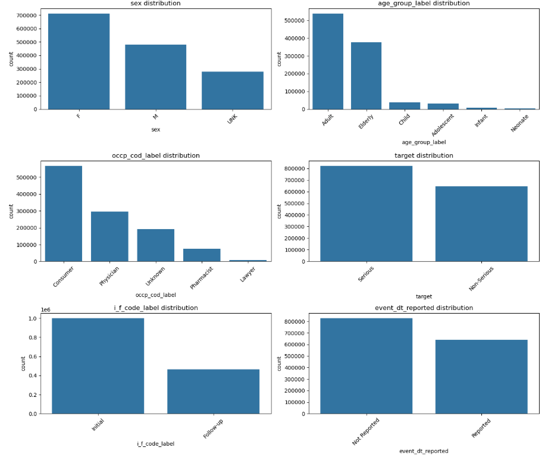

More cases come from women than men, most patients are adults or elderly, consumers report the most cases, and most reports are initial reports.

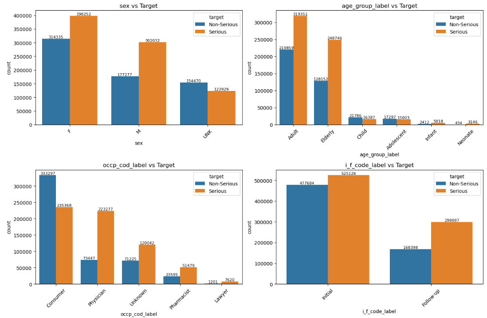

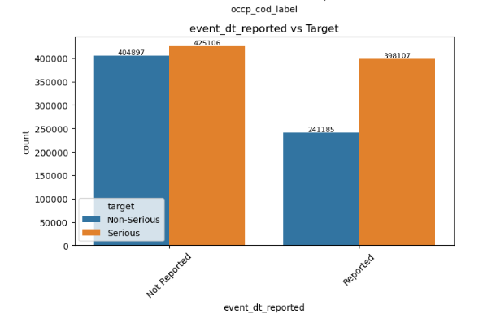

What stands out: physician-reported cases are 75% Serious versus 41% for consumers (the strongest category signal), elderly patients are 66% Serious, follow-up reports are 64% Serious versus 52% for initial reports, and cases with unknown sex lean Non-Serious (44% Serious).

**How the numbers relate to each other (correlation heatmap):**

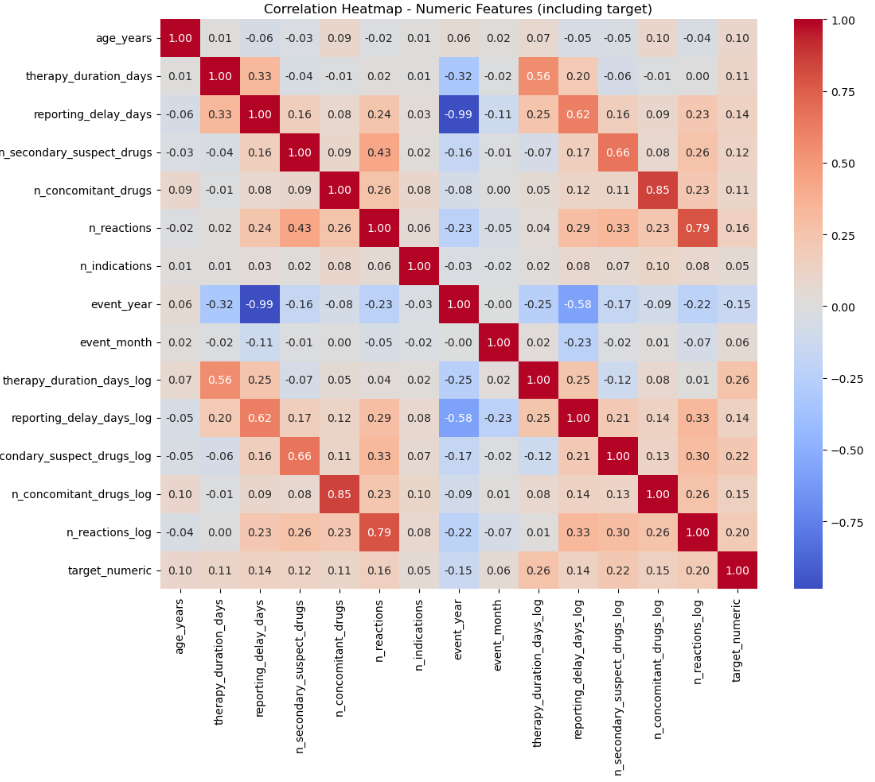

No single number is strongly linked to the answer on its own (all under 0.3). The real signal comes from many features together.

**Step 8: Choose what to keep.** IDs, raw dates, and columns used to build the answer were dropped.

**Step 9: Convert text to numbers (encoding).** Models work with numbers, so categories such as sex or reporter type were converted. Columns with thousands of values (such as drug name) were grouped into the most common ones plus an "Other" group.

To decide how many categories to keep, we checked how much of the data the most common values cover. Top 20 countries cover 96% of cases, but even the top 100 drugs cover only 48.3%, because there are 6,721 different drugs:

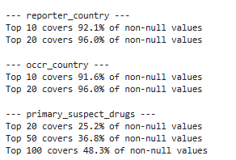

**Step 10: Split into training and testing.** 80% of cases (1,175,444) were used to teach the model and 20% (293,861) were kept aside to test it.

**Step 11: Remove features that give the answer away.** This was the most important step for honesty of the results. A model can look very accurate by using clues that would not be available in real use.

First model's most important features. The two report-type flags (EXP and PER) together carried about 60% of the importance:

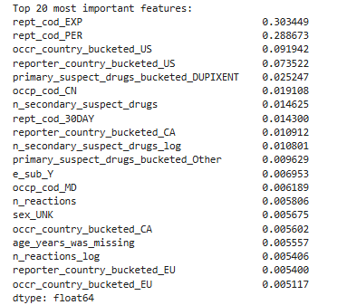

After removing report type, country became the top clue (US alone about 45%):

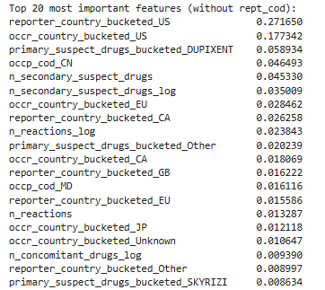

After removing country as well, the model relies on real case information: drug, number of secondary drugs, who reported, number of reactions and concomitant medications, age and therapy duration:

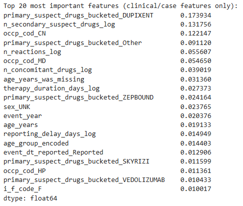

- **Report type (expedited vs periodic):** this field is decided *after* a case is judged serious, and alone carried about 60% of the model's decisions. Removed.
- **Country:** the US alone carried about 45% of the importance, because of how cases are reported rather than patient risk. Removed.
- **Reporting delay (time between event and FDA receipt):** serious cases are required to reach the FDA within 15 days, and this is not known at triage time. Removed after the first model comparison.

Removing these lowered the headline numbers, but made the model fair and usable.

**Step 12: Build a first model and check it is stable.** A Random Forest gave about 78% accuracy. Checking it on different slices of the data (cross-validation) gave very similar results each time, so it is stable.

**Step 13: Try and tune several models.** Logistic Regression, Random Forest, XGBoost and LightGBM were compared and tuned.

| Model | 2025 test accuracy | 2025 test ROC-AUC |
|---|---|---|
| Logistic Regression | 75.8% | 0.840 |
| Random Forest (tuned) | 79.3% | 0.875 |
| XGBoost (tuned) | 79.0% | 0.874 |
| LightGBM (tuned) | 79.5% | 0.880 |

**Step 14: Test on data from the future.** Q1 2026 data (397,224 cases) was processed the same way and used as a true unseen test.

| Model | Test ROC-AUC | 2026 ROC-AUC | Drop |
|---|---|---|---|
| Random Forest | 0.875 | 0.850 | 0.025 |
| LightGBM | 0.880 | 0.863 | 0.017 |
| XGBoost | 0.874 | 0.865 | 0.010 |

LightGBM looked best on the 2025 test, but XGBoost lost the least when facing new data. Because the model is meant for new incoming cases, **XGBoost was chosen**.

**Step 15: Final model without reporting delay.** Reporting delay was removed (Step 11) and XGBoost was retrained on 82 features. The cost was small:

| | With delay | Without delay |
|---|---|---|
| 2025 test accuracy | 79.0% | 78.8% |
| 2026 accuracy | 76.9% | 75.7% |
| 2026 ROC-AUC | 0.865 | 0.860 |

**Step 16: Choose the cut-off.** The model gives a probability. A cut-off decides when to call a case Serious. A lower cut-off catches more serious cases but raises false alarms.

| Cut-off | Precision | Recall | F1 |
|---|---|---|---|
| 0.3 | 70.4% | 94.7% | 80.7% |
| 0.4 | 75.6% | 89.5% | **82.0%** |
| 0.5 | 80.3% | 82.9% | 81.6% |

**0.4** was chosen as the best balance: it catches about 89.5% of truly serious cases with fewer false alarms than 0.3. (The accuracy figures above use 0.5.)

**Step 17: Understand why the model decides what it does.** A method called SHAP showed which drugs push a case towards Serious or Non-Serious. This was compared with FDA boxed warnings for 28 drugs. The match was only partial, which is expected: a drug with a serious warning is not always reported as a serious case. Carboplatin leaned Serious, while Ozempic, Mounjaro, Revlimid and Rinvoq leaned Non-Serious.

**Step 18: Build the app.** The final model was put into a Streamlit web app (below).

## 7. The app

Enter six details: **age, sex, primary suspect drug, reporter occupation, number of reactions, and number of concomitant medications.** The app returns Serious or Non-Serious with a probability.

> The model was trained on 82 features. The app asks for only six and fills the rest with typical (median) values from the training data, so its accuracy can be lower than the figures reported above.

## 8. Who could use this

- Drug companies can surface likely-serious reports for earlier review.
- Hospitals and clinicians could use a similar approach to spot patients needing closer monitoring.
- Safety-software vendors could build this into their tools.

## 9. Limitations

- FAERS reports are **unconfirmed**. They show suspected links, not proven facts.
- The model finds patterns. It **cannot show that a drug causes an outcome**.
- Much of the data is missing (for example age, occupation, weight), and filling gaps with typical values is a workaround.
- The model partly reflects **reporting behaviour** (who reports and how), not only medical risk.
- The model was trained on coded FAERS data. At real triage, some inputs would be estimated from the raw report, so performance may differ.
- It is **not suitable for regulatory decisions**. It supports prioritization by humans.

## 10. Files in this repository

| File | Purpose |
|---|---|
| `FDA 2025.ipynb` | Full notebook with every step and explanation |
| `app.py` | Streamlit app |
| Final model file(s) | Saved trained model used by the app |
| `requirements.txt` | Packages needed to run the app |
| Project report (Word) | Full written report |

## 11. How to run

**App:**

```
pip install -r requirements.txt
streamlit run app.py
```

**Notebook:** download the FAERS ASCII files from the FDA website, change `base_path` and `base_path_2026` in the loading cells to your folder, then install the packages:

```
pip install pandas numpy scikit-learn xgboost lightgbm shap seaborn matplotlib
```

## 12. References

- FDA FAERS quarterly data and documentation (including 21 CFR 314.80)
- DailyMed / NIH for drug labels and boxed warnings
- MedDRA for standard medical terminology
